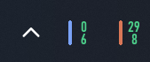
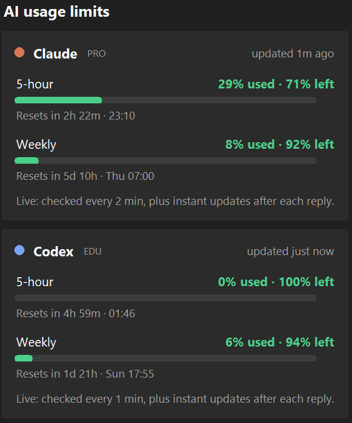

# UsageTray

**Live Claude and Codex usage limits in your Windows taskbar.** There's one icon per tool showing your 5-hour and weekly usage, coloured by how much is left. It checks live, so the numbers stay accurate even when neither app is open.

<p>
  
  &nbsp;&nbsp;
  
</p>

## What the icons mean

```
┃ 29%    top    = 5-hour usage
┃ !8%    bottom = weekly usage
^ clay stripe = Claude, blue stripe = Codex
```

| You see | Meaning |
|---|---|
| Green → yellow → **amber** → **red** number | How much is left. Amber starts at 80% used, red at 95% |
| Yellow **`!`** before the weekly number | That limit resets within **2 days** and you've used **under 50%** of it |
| Grey numbers | The reading is stale (no fresh data for over 10 min) |
| Amber tip at the bottom of the stripe | The live check isn't working. Click the icon to see why |

- **Hover** for each limit's usage and exactly when it resets.
- **Left-click** for the details panel. Each weekly bar there has a grey **"even pace" bar** behind it, showing how much you'd have used by now if you spread your usage evenly over the 7 days.
- **Right-click** for the menu: Refresh, Start with Windows, Settings, Log, Quit.

Icons are drawn at the exact pixel size your taskbar uses (16–32 px depending on display scaling), so the digits stay sharp.

## Install

Requires Windows 10/11, **Python 3.10+** (from python.org, with the default "tcl/tk" option), and Claude Code and/or Codex CLI logged in.

```bat
git clone https://github.com/Sngqih/Claude-Codex-TaskbarUsageWidgets___ClaudeVibecodedProject___.git usage-tray
cd usage-tray
setup.bat
run.bat
```

1. **`setup.bat`** creates a private Python environment in `%LOCALAPPDATA%\UsageTray\venv`, outside this folder so OneDrive and git ignore it. It then installs two packages and runs `probe.py`, which prints what it can read from Claude and Codex.
2. **`run.bat`** starts UsageTray in the background.
3. New tray icons start hidden behind the **^** arrow. Drag them onto the taskbar to keep them visible, or turn them on in *Settings → Personalization → Taskbar → Other system tray icons*.
4. Right-click an icon and tick **Start with Windows**.
5. Optional: run **`install_claude_statusline.bat`** for instant Claude updates while you use Claude Code (see below).

You can also download a standalone `UsageTray.exe` from the **Releases** page, which needs no Python. Or build one yourself with `build_exe.bat`.

## Where the numbers come from

| | Live check (main source) | Instant updates (extra) |
|---|---|---|
| **Claude** | Every 2 min, using the login Claude Code saved in `%USERPROFILE%\.claude\.credentials.json`. This is the same data as Claude Code's `/usage`, including claude.ai and app usage | After each Claude Code reply, via a status line hook (`install_claude_statusline.bat`) |
| **Codex** | Every 1 min, it briefly starts `codex app-server` and sends `account/rateLimits/read` using your Codex login | After each Codex reply, from `%USERPROFILE%\.codex\sessions\…` logs |

- **It never undercounts.** Usage inside one limit window only goes up, so when two readings disagree the higher one wins, and a reset starts fresh.
- **Your Claude token is only read, never refreshed or copied**, and it's only sent to Anthropic.
- **If the Claude token expires or goes blank:** on Windows, Claude Code sometimes doesn't save its refreshed token. When that happens, the icon shows the amber tip and the panel says so. Run `claude auth login` in a terminal to fix it. `probe.py` shows when the saved token expires.
- **The status line installer** backs up Claude Code's `settings.json` and keeps any status line you already have. `remove_claude_statusline.bat` undoes it.

## Battery

- The app sleeps between checks.
- Each live check is one small request: Claude every 2 min, Codex every 1 min.
- Checking for instant updates means reading a few file timestamps every 5 s.
- All intervals double on battery.
- It refreshes straight away after the laptop wakes.
- Expect roughly 0% CPU and about 40 MB of memory.

## Settings

Right-click an icon and choose **Open settings file** (`%APPDATA%\UsageTray\config.json`). Restart UsageTray to apply changes. The log file is `%APPDATA%\UsageTray\usage-tray.log`.

| Key | Default | Meaning |
|---|---|---|
| `claude_live_interval_s` | 120 | Seconds between live Claude checks (on mains power) |
| `codex_live_interval_s` | 60 | Seconds between live Codex checks |
| `file_check_interval_s` | 5 | Seconds between instant-update checks (no network) |
| `battery_multiplier` | 2.0 | All intervals × this on battery |
| `warn_pct` / `crit_pct` | 80 / 95 | Amber/red levels and notification points |
| `underuse_pct` / `underuse_days` | 50 / 2 | Show `!` when a weekly limit resets within this many days and you've used less than this % |
| `notify` | true | Windows notification when a limit crosses the amber/red levels (once per reset period) |
| `show_claude` / `show_codex` | true | Hide one of the icons |
| `claude_config_dir` / `codex_home` | null | Override data folders (otherwise `CLAUDE_CONFIG_DIR` / `CODEX_HOME` or the defaults) |
| `codex_command` | null | How to start Codex if `codex` isn't on PATH, e.g. `"C:\\path\\to\\codex.cmd"` |

## Caveats

Neither the Claude usage endpoint nor `codex app-server` is an official, stable API. If either changes, that icon shows an error rather than wrong numbers. The fix lives in one file: `usagetray/providers/claude.py` or `codex.py`.

## Development

```bat
python -m pip install Pillow pyflakes
python -m unittest discover -s tests
```

- **Tests** run offline: a fake Anthropic server, a fake `codex app-server` (`tests/fake_codex.py`) and fake session logs. GitHub Actions runs them on Windows and Linux for every push.
- **Releases:** first bump `__version__` in `usagetray/__init__.py` and add a `CHANGELOG.md` entry. Then, on GitHub, open **Actions → release → Run workflow** and enter the tag (e.g. `v0.5.0`). Or push the tag from a terminal: `git tag v0.5.0 && git push origin v0.5.0`. The workflow tests the code, builds `UsageTray.exe`, smoke-tests it, and publishes the release.
- **Project notes** for contributors (and AI assistants) are in [`CLAUDE.md`](CLAUDE.md), and the version history is in [`CHANGELOG.md`](CHANGELOG.md).

```
main.py                 start the app
probe.py                print both readings in the console (diagnostics)
claude_statusline.py    Claude Code status line hook
install_claude_statusline.py (+ .bat files)
usagetray/
  providers/base.py     live + file sources merged, "not live" / stale logic
  providers/claude.py   Anthropic usage endpoint + status line file
  providers/codex.py    codex app-server client + session-log reader
  model.py              Snapshot / Window data, no-undercount merge, pace maths
  poller.py             background refresh threads + last-value cache
  icon.py               tray icon drawing + hover text
  flyout.py             click-open details panel (tkinter)
  tray.py               pystray icons + menu (exact-size icon loading)
  winutil.py            DPI, tray icon size, theme, battery, autostart, single instance
  app.py                wires it all together
tests/                  offline tests
```

## Licence

MIT. See [LICENSE](LICENSE).
